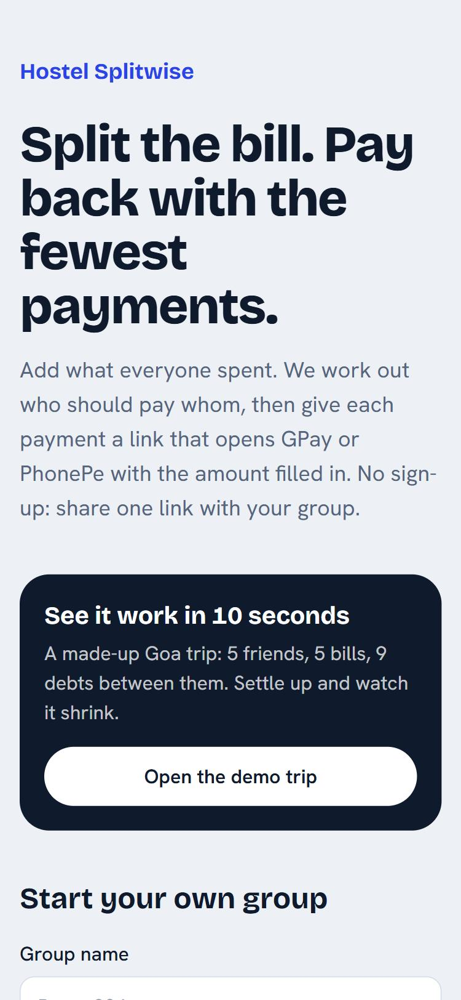
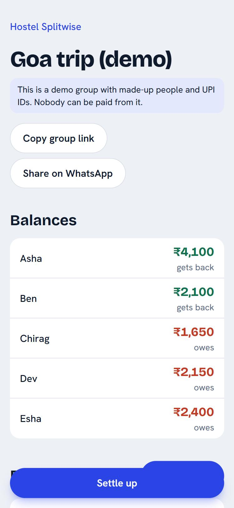
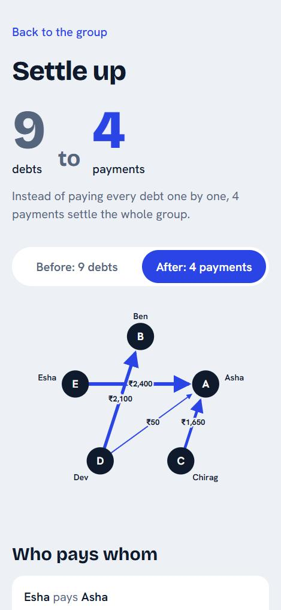
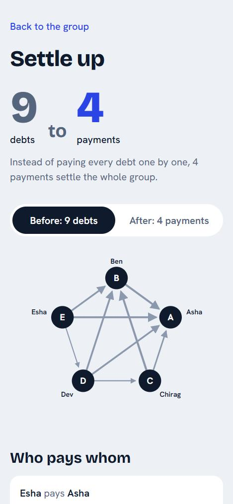
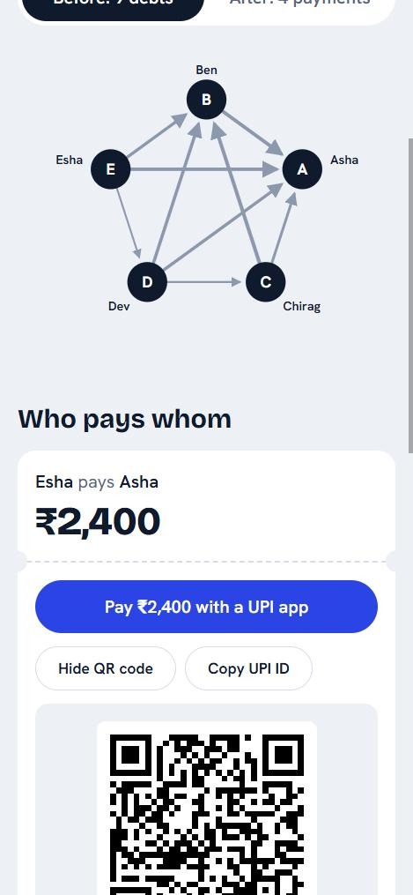
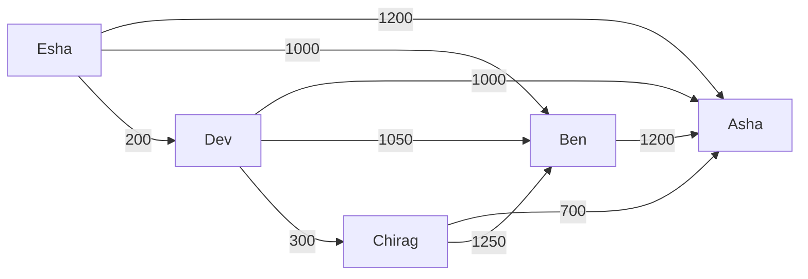
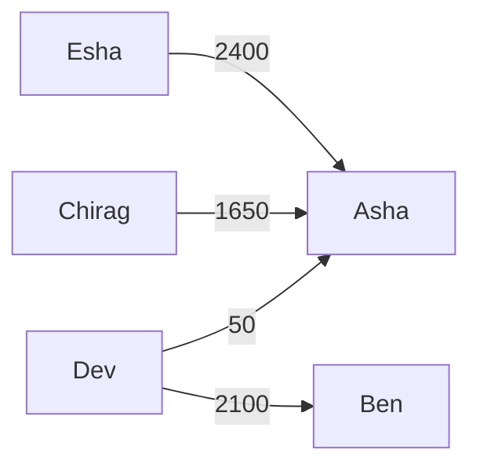

# Hostel Splitwise

[](https://github.com/rkaran112/hostel-splitwise/actions/workflows/ci.yml)

Split group expenses (hostel rent, trips, food) and **settle up with the fewest payments**. Every payment comes with a UPI link that opens GPay or PhonePe with the amount filled in. The app only builds links. It never touches money.

**Live demo:** coming soon, see [Deploy](#deploy-free-tier). Until then, run it locally in a few minutes: [Run it on Windows](#run-it-on-windows-no-docker).

<table>
  <tr>
    <td></td>
    <td></td>
    <td></td>
  </tr>
  <tr>
    <td align="center">Start a group, or open the demo trip</td>
    <td align="center">Balances: who is owed, who owes</td>
    <td align="center">Settle up: 9 debts become 4 payments</td>
  </tr>
  <tr>
    <td></td>
    <td></td>
    <td></td>
  </tr>
  <tr>
    <td align="center">The same group before: 9 debts</td>
    <td align="center">One payment: UPI button and QR code</td>
    <td></td>
  </tr>
</table>

These screenshots are from a local run of the demo trip.

## The problem

Five friends go on a trip. Different people pay for the hotel, the food and the cab. At the end everyone owes everyone a little, and the usual fix is a group chat full of "send me 450" messages.

Two things make that painful:

1. **Too many payments.** Paying each debt one by one can take 9 payments when 4 would do.
2. **Too much typing.** Each payment means finding the person's UPI ID and typing the amount.

This app adds up what everyone paid, works out a short list of payments, and gives each one a UPI link.

## Things to know first

- **Anyone with a group's link can see and edit it.** There are no passwords and no accounts, on purpose. The link contains a random 64-bit token, so it cannot be guessed, but treat it like a shared note: send it only to your group.
- **The settle-up plan is not always the absolute minimum.** The greedy algorithm never needs more than n − 1 payments, but finding the true minimum is NP-hard. A test shows a case where greedy uses 4 payments and 3 are possible. See [Where greedy is not perfectly optimal](#where-greedy-is-not-perfectly-optimal).
- **The app never touches money.** It only builds `upi://pay` links. The payment happens in your UPI app, and you confirm it there.
- **The free hosting sleeps.** On the live site the first request after a quiet spell can take up to a minute while the free server wakes up. The pages say so while they wait.
- **No database migrations.** Tables are created on start-up. That keeps the code small enough to explain, but a real product would use a migration tool.

## How to read this repo in 10 minutes

1. [`backend/app/settle.py`](backend/app/settle.py): the two-heap algorithm (about 60 lines of logic).
2. [`backend/tests/test_settle.py`](backend/tests/test_settle.py): edge cases, random checks, and the counterexample.
3. [`backend/app/money.py`](backend/app/money.py) and [`balances.py`](backend/app/balances.py): paise, equal splits, net balances.
4. [`backend/app/main.py`](backend/app/main.py): the routes, each a few lines.
5. [`frontend/app/g/[id]/settle/page.tsx`](frontend/app/g/[id]/settle/page.tsx): the settle page.

---

## The settle-up algorithm

### The problem, in numbers

Five friends go on a trip and pay for different things. Everyone owes everyone a bit. Paying each debt one by one means **9 separate payments**. Can we do it in fewer?

Yes. Only each person's **net balance** matters: *what they paid* minus *what they should have paid*.

- positive balance → the group owes them (a **creditor**)
- negative balance → they owe the group (a **debtor**)
- all balances add up to exactly 0

### The idea in one sentence

> Make the person who owes the **most** pay the person who is owed the **most**, as much as possible. Repeat.

Each payment fully settles at least one person, so people drop out quickly.

### Worked example

Expenses (all split equally between the people listed):

| Expense | Paid by | Amount | Split between |
|---|---|---|---|
| Hotel | Asha | ₹6000 | all 5 |
| Food | Ben | ₹5000 | Ben, Chirag, Dev, Esha |
| Cab | Chirag | ₹1500 | Asha, Chirag, Dev |
| Tickets | Dev | ₹1000 | all 5 |
| Snacks | Esha | ₹500 | Ben, Esha |

Net balances (paid − share):

| Person | Balance |
|---|---|
| Asha | **+₹4100** (is owed) |
| Ben | **+₹2100** (is owed) |
| Chirag | −₹1650 (owes) |
| Dev | −₹2150 (owes) |
| Esha | −₹2400 (owes) |

Run the algorithm. Each row picks the biggest debtor and the biggest creditor:

| Step | Biggest debtor | Biggest creditor | Payment | Still unsettled afterwards |
|---|---|---|---|---|
| 1 | Esha (2400) | Asha (4100) | Esha → Asha **₹2400** | Dev 2150, Chirag 1650 owe · Ben 2100, Asha 1700 owed |
| 2 | Dev (2150) | Ben (2100) | Dev → Ben **₹2100** | Chirag 1650, Dev 50 owe · Asha 1700 owed |
| 3 | Chirag (1650) | Asha (1700) | Chirag → Asha **₹1650** | Dev 50 owes · Asha 50 owed |
| 4 | Dev (50) | Asha (50) | Dev → Asha **₹50** | nobody |

**Before: 9 debts. After: 4 payments.**

#### The debts before and after

Before: every pair of people who owe each other (arrows point from debtor to creditor).



After: the settle-up plan.



### How it works in code

[`backend/app/settle.py`](backend/app/settle.py) — about 60 lines of logic.

1. Split people into **creditors** and **debtors**; people at 0 are ignored.
2. Put each group in a **heap** so "who is the biggest?" is fast.
   Python's `heapq` is a *min*-heap, so amounts are stored as **negatives** (−2400 comes out before −2100).
3. Loop: pop the biggest debtor and the biggest creditor, pay `min(debt, credit)`.
4. Whoever still has money left is pushed back with the smaller amount.
5. Stop when the heaps are empty.

### Complexity

Let **n** be the number of people with a non-zero balance.

- **At most n − 1 payments.** Every payment settles at least one person, and the very last one settles two (the balances sum to 0).
- **Time: O(n log n).** Building the heaps is O(n). The loop runs at most n − 1 times; each round does two pops and up to two pushes, each O(log n).
- **Space: O(n)** for the heaps.
- The "show me how" walkthrough copies the remaining people after each step, which makes *that* part O(n² log n). Group sizes are tiny, so this is fine, but the algorithm itself stays O(n log n).

### Why greedy works (and what it guarantees)

- **It always finishes with everyone at 0.** A payment of `min(debt, credit)` never overpays anyone. Because the balances sum to 0, when the debtors are gone the creditors are gone too.
- **It never uses more than n − 1 payments** (shown above). That is a ceiling, not a promise of the best case.
- **Biggest-with-biggest tends to settle large chunks at once**, so people leave the problem quickly.

### Where greedy is *not* perfectly optimal

The true minimum number of payments is

> **n − (the maximum number of groups you can split people into where each group's balances add up to 0)**

A group of k people that cancels out among themselves needs only k − 1 payments. Finding the best split into zero-sum groups is the **subset-sum problem in disguise, which is NP-hard**. Greedy does not look for those groups.

Counterexample (in the tests): balances `A +8, B +6, C −6, D −4, E −4`.

- **Best (3 payments):** `{B, C}` cancel out, and `{A, D, E}` cancel out → C→B 6, D→A 4, E→A 4.
- **Greedy (4 payments):** C→A 6, D→B 4, E→B 2, E→A 2. Paying A first with the biggest debtor split E's debt into two payments.

How often does this happen? On 2000 random groups per size (random balances, checked against the
brute-force solver), greedy matched the optimum **2000/2000** times for 4 and 5 people, **1998/2000** for 6 and **1986/2000** for 8.
Random balances rarely contain a zero-sum subgroup, so real trips with round-number bills can hit this case a bit more often. The tests check `best <= greedy <= n - 1` on 200 random groups of up to 9 people.

---

## Money is stored in paise

Every amount in the app is a whole number of **paise** (₹12.50 → `1250`). Floats cannot add `0.1 + 0.2` correctly; integers can. Rupees only appear when a person types an amount and when we display one. The parser never uses `float()`: it splits the text at the dot and reads two whole numbers.

Splitting ₹100 among 3 people gives `3334 + 3333 + 3333` paise. The leftover paise go one each to the first people in the list, so the shares always add up to the bill exactly.

## UPI links

```
upi://pay?pa=<their UPI ID>&pn=<name>&am=<amount in rupees>&cu=INR
```

Built in [`backend/app/upi.py`](backend/app/upi.py). Names are URL-encoded, so a name like `Tom & Jerry` cannot break the link. On a phone the link opens GPay, PhonePe or Paytm. On a computer nothing handles `upi://`, so every payment also has a QR code to scan with a phone.

The UPI IDs in the demo trip are made up (the bank part is `upi`, which does not exist), so no real person can be paid from it.

## How it fits together

```
 phone / browser
      |
      |  Next.js + Tailwind  (Vercel)
      v
 FastAPI API  (Render) ------>  PostgreSQL  (Supabase)
      |
      +-- settle.py, balances.py, money.py, upi.py
          plain Python functions: no web, no database
```

- The **algorithm files are pure functions.** They take dicts and return dicts, so they are easy to test and easy to explain.
- [`service.py`](backend/app/service.py) is the glue: it reads rows from the database, turns them into those dicts, and shapes the answers.
- [`main.py`](backend/app/main.py) is only routes. Each one finds the group, checks the input, calls `service.py`, and returns.
- **SQLite on a laptop, PostgreSQL live.** The same SQLAlchemy code runs on both; the `DATABASE_URL` environment variable chooses. CI runs the tests on both.

### Tables

| Table | Holds |
|---|---|
| `groups` | one row per group; `id` is the random token in the shareable link |
| `members` | the people in a group, with an optional UPI ID |
| `expenses` | one row per bill: who paid, the amount in paise, equal or exact split |
| `expense_shares` | one row per person per bill: that person's share in paise |

Shares are saved when the bill is added, so a bill's split can never change later. Deleting an expense only sets `deleted_at`, so the usage counter stays truthful.

### API

| Method and path | What it does |
|---|---|
| `POST /api/groups` | create a group with its people |
| `POST /api/groups/demo` | create the demo Goa trip |
| `GET /api/groups/{id}` | people, expenses and balances |
| `POST /api/groups/{id}/members` | add a person |
| `PATCH /api/groups/{id}/members/{member_id}` | set or change a UPI ID |
| `POST /api/groups/{id}/expenses` | add an expense (equal or exact split) |
| `DELETE /api/groups/{id}/expenses/{expense_id}` | remove an expense |
| `GET /api/groups/{id}/settle` | the debts before, the payments after, the UPI links, the steps |
| `GET /api/stats` | usage counter |
| `GET /api/health` | health check for the host |

Amounts in requests are rupees as text (`"250.50"`), parsed on the server. Amounts in responses are whole paise. When the API runs, its interactive docs are at `/docs`.

## Run it on Windows (no Docker)

You need Python 3.13 and Node 22. No database to install: locally the API uses a SQLite file.

**API** (in one terminal):

```powershell
cd backend
py -3.13 -m venv .venv
.\.venv\Scripts\python.exe -m pip install -r requirements.txt
.\.venv\Scripts\python.exe -m uvicorn app.main:app --reload
```

**Website** (in a second terminal):

```powershell
cd frontend
npm install
$env:NEXT_PUBLIC_API_URL = "http://localhost:8000"
npm run dev
```

Open http://localhost:3000 and press "Open the demo trip".

## Tests and CI

```powershell
cd backend
.\.venv\Scripts\python.exe -m pytest -v
```

93 tests, 97% line coverage (`pytest --cov=app`).

| File | What it checks |
|---|---|
| `test_settle.py` | everyone even, one person owes all, one person is owed by all, rounding, balances that do not add up; 300 random groups (at most n − 1 payments, everyone ends at 0); greedy against a brute-force optimum; the counterexample |
| `test_money.py` | rupees to paise, bad amounts, the ₹100 ÷ 3 rounding, equal and exact splits |
| `test_balances.py` | net balances sum to 0; the before-debts count and amounts |
| `test_upi.py` | link format, URL-encoding of names, bad UPI IDs |
| `test_api.py` | every route against a real temporary database: validation, soft delete, UPI links, demo group, usage counter |
| `test_db.py` | `DATABASE_URL` handling |

GitHub Actions ([`ci.yml`](.github/workflows/ci.yml)) runs on every push:

- backend tests on SQLite
- backend tests on a real PostgreSQL 16 service
- frontend lint and production build

To run the API tests against a PostgreSQL you already have, set `TEST_DATABASE_URL` before `pytest`. The tests drop and recreate their tables, so use an empty database.

## Usage counter

`GET /api/stats` returns the number of groups and expenses ever created:

```json
{"groups": 12, "expenses": 87, "demo_groups": 31}
```

The home page shows the first two in its footer. Demo groups are counted separately, so trying the demo does not inflate the real numbers. Deleted expenses still count as created. To read the numbers for a CV:

```powershell
curl https://<your-api>.onrender.com/api/stats
```

## Deploy (free tier)

Three free services, set up in this order. Sign-ups and passwords are yours to do in each dashboard.

1. **Database: Supabase.** Create a project. Open *Connect* and copy the **Session pooler** connection string. Use the pooler, not the "Direct connection": Render cannot reach Supabase's direct address because it is IPv6-only. Put your database password into the string.
2. **API: Render.** *New → Blueprint*, pick this repository. [`render.yaml`](render.yaml) creates the service. When asked, set `DATABASE_URL` to the Supabase string. Leave `ALLOWED_ORIGINS` for step 4. The API address looks like `https://hostel-splitwise-api.onrender.com`; `/api/health` should answer `{"status":"ok"}`.
3. **Website: Vercel.** *Add New → Project*, pick this repository, set **Root Directory** to `frontend`, and add the environment variable `NEXT_PUBLIC_API_URL` = your Render address. Deploy.
4. **Connect them.** In Render, set `ALLOWED_ORIGINS` to the Vercel address (for example `https://hostel-splitwise.vercel.app`) and redeploy. Without this the browser blocks the website from calling the API.
5. **Keep both awake.** In GitHub, *Settings → Secrets and variables → Actions → Variables*, add `API_URL` = your Render address. [`keepalive.yml`](.github/workflows/keepalive.yml) then pings the API twice a week, which wakes Render and queries Supabase so it does not pause for inactivity.

---

## Interview talking points

**Why paise and not rupees with decimals?**
Floats cannot represent most decimals exactly (`0.1 + 0.2 != 0.3`), and money errors add up. Whole paise are integers, so sums are exact. I only convert at the edges, and the parser splits the text instead of calling `float()`.

**How do you split ₹100 among 3?**
10000 paise ÷ 3 = 3333 remainder 1. The leftover paise are handed out one each to the first people, giving 3334, 3333, 3333. The shares always add up to the bill, which a test checks for many totals and group sizes.

**Explain the algorithm.**
Work out each person's net balance (paid minus share). Put creditors in one max-heap and debtors in another. Repeatedly take the biggest debtor and the biggest creditor, pay `min(debt, credit)`, and push back whoever has something left. Python's `heapq` is a min-heap, so I store negative amounts.

**What is the complexity, and how do you know there are at most n − 1 payments?**
O(n log n) time and O(n) space: building the heaps is O(n), and the loop runs at most n − 1 times with O(log n) work each. Every payment settles at least one person, and the last one settles two because the balances sum to zero.

**Is it optimal?**
Not always. The minimum is n minus the maximum number of groups whose balances each sum to zero, and finding that is NP-hard (it contains subset-sum). My test has `A+8, B+6, C−6, D−4, E−4`: optimal is 3 payments, greedy uses 4. On random groups it matched a brute-force optimum 2000/2000 times for 4 and 5 people and 1986/2000 for 8. For small groups an exact solver is feasible: the brute-force one in `tests/helpers.py` is a bitmask DP, so moving it into the app for groups up to about 15 people would be a natural next step.

**What if two people tie for the biggest debt?**
Heap entries are `(-amount, person id)`, so ties break by id. Any choice is valid, and this one makes the output deterministic, which the tests rely on.

**How did you test the algorithm?**
Hand-written edge cases (everyone even, one person owes all, rounding, a single paisa), then properties on 300 random groups with a fixed seed: no payment is zero or to oneself, only debtors pay, only creditors receive, everyone ends at exactly 0, and never more than n − 1 payments. Then a brute-force oracle to compare against the true optimum.

**Why keep the algorithm separate from the web code?**
`settle.py`, `balances.py`, `money.py` and `upi.py` import nothing from FastAPI or SQLAlchemy. They are plain functions on dicts, so tests need no database and I can explain them in isolation.

**Why store each person's share instead of recomputing it?**
So a bill never changes after the fact, even if the splitting rule changes later. It also makes exact-amount splits and equal splits look the same to the balance code.

**Why soft-delete expenses?**
A typo should be removable, but the usage counter should count what was created. Setting `deleted_at` does both.

**How do groups work without logins?**
The group id is a random token (`secrets.token_urlsafe(8)`, 64 bits) in the link. It cannot be guessed, but anyone holding the link can edit, and I say so in the README. For a real product I would add per-person edit rights.

**SQLite locally and PostgreSQL live: how?**
SQLAlchemy hides the difference. `DATABASE_URL` chooses the database, and a small function rewrites `postgresql://` to `postgresql+psycopg://` so the right driver loads. CI runs the full test suite against both.

**What is CORS and why did you need it?**
A browser only lets a website call another address if that address allows it. The API reads `ALLOWED_ORIGINS` and allows only my Vercel site; on a laptop it allows any localhost port.

**What did free hosting teach you?**
Render's free server sleeps after 15 quiet minutes, so the first request is slow and the UI says so. Supabase pauses idle free projects, so a GitHub Actions job pings the API twice a week. Render cannot reach Supabase's IPv6-only direct address, so the connection uses the Session pooler.

**What would you do next?**
Per-person edit rights, database migrations, rate limiting on the public create routes, an exact solver for small groups, and a "mark as paid" tick on each payment.

---

## Files

| Path | What it does |
|---|---|
| `backend/app/money.py` | rupees ↔ paise, equal split, exact-split check |
| `backend/app/balances.py` | net balance per person; the debts before settling |
| `backend/app/settle.py` | the two-heap greedy algorithm |
| `backend/app/upi.py` | builds the UPI link |
| `backend/app/models.py`, `db.py` | the four tables and the database connection |
| `backend/app/schemas.py` | what the API accepts |
| `backend/app/service.py` | glue between database rows and the algorithm; the demo group; usage stats |
| `backend/app/main.py` | the routes |
| `backend/tests/` | 93 tests |
| `frontend/` | Next.js website; see [`frontend/README.md`](frontend/README.md) |
| `render.yaml` | Render service description |
| `.github/workflows/` | CI and the keep-alive ping |
