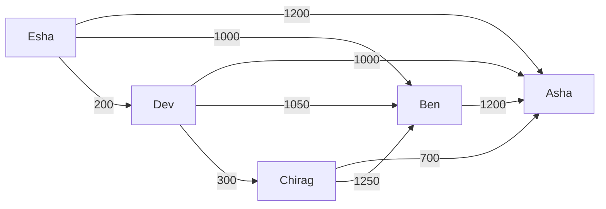
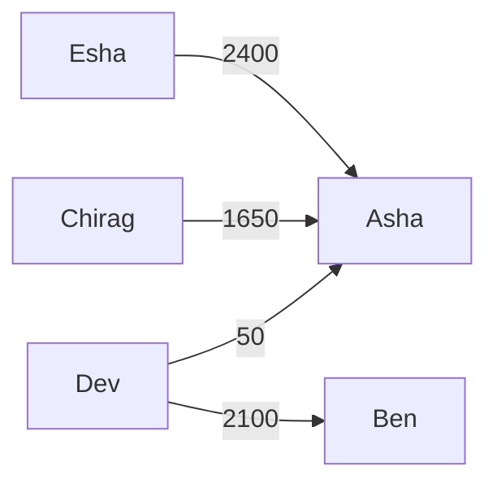

# Hostel Splitwise

> **Status: Phase 1 of 5 — the algorithm and its tests.** The API, the app and the live link come next; this README grows with them. Only the settle-up section is written so far.

Split group expenses (hostel rent, trips, food) and **settle up with the fewest payments**, each with a UPI link that opens GPay / PhonePe with the amount filled in. The app only builds links. It never touches money.

---

## The settle-up algorithm

### The problem

Five friends go on a trip and pay for different things. Everyone owes everyone a bit. Paying each debt one by one means **9 separate payments**. Can we do it in fewer?

Yes. Only each person's **net balance** matters: *what they paid* minus *what they should have paid*.

- positive balance → the group owes them (a **creditor**)
- negative balance → they owe the group (a **debtor**)
- all balances add up to exactly 0

### The idea in one sentence

> Make the person who owes the **most** pay the person who is owed the **most**, as much as possible. Repeat.

Each payment fully settles at least one person, so people drop out quickly.

### Worked example

Expenses (all split equally between the people listed):

| Expense | Paid by | Amount | Split between |
|---|---|---|---|
| Hotel | Asha | ₹6000 | all 5 |
| Food | Ben | ₹5000 | Ben, Chirag, Dev, Esha |
| Cab | Chirag | ₹1500 | Asha, Chirag, Dev |
| Tickets | Dev | ₹1000 | all 5 |
| Snacks | Esha | ₹500 | Ben, Esha |

Net balances (paid − share):

| Person | Balance |
|---|---|
| Asha | **+₹4100** (is owed) |
| Ben | **+₹2100** (is owed) |
| Chirag | −₹1650 (owes) |
| Dev | −₹2150 (owes) |
| Esha | −₹2400 (owes) |

Run the algorithm. Each row picks the biggest debtor and the biggest creditor:

| Step | Biggest debtor | Biggest creditor | Payment | Still unsettled afterwards |
|---|---|---|---|---|
| 1 | Esha (2400) | Asha (4100) | Esha → Asha **₹2400** | Dev 2150, Chirag 1650 owe · Ben 2100, Asha 1700 owed |
| 2 | Dev (2150) | Ben (2100) | Dev → Ben **₹2100** | Chirag 1650, Dev 50 owe · Asha 1700 owed |
| 3 | Chirag (1650) | Asha (1700) | Chirag → Asha **₹1650** | Dev 50 owes · Asha 50 owed |
| 4 | Dev (50) | Asha (50) | Dev → Asha **₹50** | nobody |

**Before: 9 debts. After: 4 payments.**

#### The debts before and after

Before: every pair of people who owe each other (arrows point from debtor to creditor).



After: the settle-up plan.



### How it works in code

[`backend/app/settle.py`](backend/app/settle.py) — about 60 lines of logic.

1. Split people into **creditors** and **debtors**; people at 0 are ignored.
2. Put each group in a **heap** so "who is the biggest?" is fast.
   Python's `heapq` is a *min*-heap, so amounts are stored as **negatives** (−2400 comes out before −2100).
3. Loop: pop the biggest debtor and the biggest creditor, pay `min(debt, credit)`.
4. Whoever still has money left is pushed back with the smaller amount.
5. Stop when the heaps are empty.

### Complexity

Let **n** be the number of people with a non-zero balance.

- **At most n − 1 payments.** Every payment settles at least one person, and the very last one settles two (the balances sum to 0).
- **Time: O(n log n).** Building the heaps is O(n). The loop runs at most n − 1 times; each round does two pops and up to two pushes, each O(log n).
- **Space: O(n)** for the heaps.
- The "show me how" walkthrough copies the remaining people after each step, which makes *that* part O(n² log n). Group sizes are tiny, so this is fine, but the algorithm itself stays O(n log n).

### Why greedy works (and what it guarantees)

- **It always finishes with everyone at 0.** A payment of `min(debt, credit)` never overpays anyone. Because the balances sum to 0, when the debtors are gone the creditors are gone too.
- **It never uses more than n − 1 payments** (shown above). That is a ceiling, not a promise of the best case.
- **Biggest-with-biggest tends to settle large chunks at once**, so people leave the problem quickly.

### Where greedy is *not* perfectly optimal

The true minimum number of payments is

> **n − (the maximum number of groups you can split people into where each group's balances add up to 0)**

A group of k people that cancels out among themselves needs only k − 1 payments. Finding the best split into zero-sum groups is the **subset-sum problem in disguise, which is NP-hard**. Greedy does not look for those groups.

Counterexample (in the tests): balances `A +8, B +6, C −6, D −4, E −4`.

- **Best (3 payments):** `{B, C}` cancel out, and `{A, D, E}` cancel out → C→B 6, D→A 4, E→A 4.
- **Greedy (4 payments):** C→A 6, D→B 4, E→B 2, E→A 2. Paying A first with the biggest debtor split E's debt into two payments.

How often does this happen? On 2000 random groups per size (random balances, checked against the
brute-force solver), greedy matched the optimum **2000/2000** times for 4 and 5 people, **1998/2000** for 6 and **1986/2000** for 8.
Random balances rarely contain a zero-sum subgroup, so real trips with round-number bills can hit this case a bit more often. The tests check `best <= greedy <= n - 1` on 200 random groups of up to 9 people.

---

## Money is stored in paise

Every amount in the app is a whole number of **paise** (₹12.50 → `1250`). Floats cannot add `0.1 + 0.2` correctly; integers can. Rupees only appear when a person types an amount and when we display one. The parser never uses `float()`.

Splitting ₹100 among 3 people gives `3334 + 3333 + 3333` paise. The leftover paise go one each to the first people, so shares always add up to the bill exactly.

## UPI links

```
upi://pay?pa=<their UPI ID>&pn=<name>&am=<amount in rupees>&cu=INR
```

Built in [`backend/app/upi.py`](backend/app/upi.py). Names are URL-encoded, so a name like `Tom & Jerry` cannot break the link.

## Run the tests

From the `backend` folder on Windows (no Docker needed):

```powershell
py -3.13 -m venv .venv
.\.venv\Scripts\python.exe -m pip install -r requirements.txt
.\.venv\Scripts\python.exe -m pytest -v
```

## Files so far

| File | What it does |
|---|---|
| `backend/app/money.py` | rupees ↔ paise, equal split, exact-split check |
| `backend/app/balances.py` | net balance per person, and the "before" debt count |
| `backend/app/settle.py` | the two-heap greedy algorithm |
| `backend/app/upi.py` | builds the UPI link |
| `backend/tests/` | 69 tests, including edge cases and a brute-force check |
